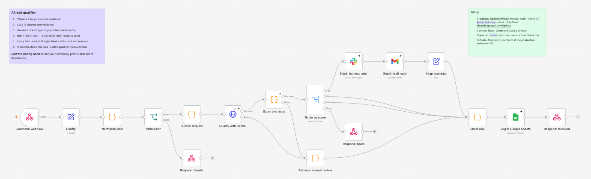

# AI lead qualifier for n8n

An n8n workflow that reads every inbound lead from your website form, scores it against your ideal client with Gemini, and acts on it. Hot leads go to Slack with a reply already drafted in Gmail. Every lead lands in Google Sheets with a score and the reasons behind it. Spam is dropped quietly.



## What happens to a lead

1. **Webhook** receives the form post (any form tool that can POST JSON: Webflow, WordPress, Typeform, your own site).
2. **Normalize** cleans the fields, accepts common field names (`email`/`Email`/`your-email`…), and rejects bad emails with HTTP 400.
3. **Build AI request** sends Gemini the lead plus your company profile from **Config**. Structured JSON output, temperature 0.2. Only the email *domain* goes to the model, not the address.
4. **Score and route**: the model returns a 0–100 score and a spam flag. Your thresholds in Config decide hot / warm / cold, not the model, so you can tune "how hot is hot" without touching the prompt.
5. **Hot** → Slack alert with score, budget, timeline and reasons → Gmail **draft** reply that mentions something specific from their message (a draft, never auto-sent).
6. **Every real lead** → one row in Google Sheets with fixed columns.
7. **If Gemini is down or returns garbage**, the lead is still logged as `review` with the error, so nothing is lost. The HTTP node retries 3 times first.
8. The webhook replies `{ ok, id, category, score }`. Spam just gets `{ ok: true }`.

## Setup (about 10 minutes)

1. In n8n: **Import from file** → `workflows/ai-lead-qualifier.json`.
2. Create a **Header Auth** credential named `Gemini API key`: header name `x-goog-api-key`, value = a key from https://aistudio.google.com/apikey (free tier is fine to start).
3. Connect your **Slack**, **Gmail** and **Google Sheets** credentials on those three nodes.
4. Make a Google Sheet with a tab called `Leads` and this header row:
   `Lead ID, Received, Category, Score, Name, Email, Company, Website, Intent, Budget, Timeline, Summary, Reasons, Message, Source, Qualified by`
5. Open **Config** and set:

   | Field | What it does |
   |---|---|
   | `companyName`, `senderName` | used in the prompt and the reply signature |
   | `companyProfile` | what you sell and who your ideal client is. The better this is, the better the scores |
   | `hotScore`, `warmScore` | thresholds, default 75 and 45 |
   | `slackChannel` | e.g. `#sales-leads` |
   | `sheetId`, `sheetTab` | your sheet's ID (from its URL) and tab name |
   | `geminiModel` | default `gemini-flash-latest` |

6. Publish the workflow and point your form at the production webhook URL (`…/webhook/lead-intake`).

Try it with sample leads:

```bash
python scripts/send_test_leads.py https://your-n8n/webhook/lead-intake
```

## Tests

```bash
npm install -g n8n
python tests/run_workflow_tests.py
```

This runs the workflow end to end in a real, throwaway n8n with no real accounts. A local mock stands in for Gemini, and Slack, Gmail and Sheets are swapped for HTTP calls to the mock so the test can see what each would have received. Every other node is the production node. Seven leads go through the real webhook: hot, warm, cold, spam, invalid email, AI outage, and AI returning garbage. 21 checks cover responses, routing, what was sent to the model, sheet columns and the fallbacks.

```
PASS  invalid email → HTTP 400 with reason
PASS  full email address not sent to the AI (domain only)
PASS  hot lead → one Slack alert with score
PASS  hot lead → one Gmail draft to the lead, with the AI reply
PASS  AI outage → kept for manual review
...
21/21 checks passed
```

## Editing the workflow

The workflow JSON is generated from `scripts/build_workflow.py`. The prompt, the response schema, the routing and the sheet columns live there as readable code. Change it, then:

```bash
python scripts/build_workflow.py && python tests/run_workflow_tests.py
```

If you edit in the n8n UI instead, that works too. Export the JSON afterwards.

## Self-hosting n8n

`docker-compose.yml` runs n8n with persistent storage:

```bash
docker compose up -d     # http://localhost:5678
```

For production, put it behind HTTPS and set `WEBHOOK_URL` to your public URL.

Built by [Azam Ali](https://github.com/azamali992). Need this wired to your own form, CRM or helpdesk? Get in touch.
